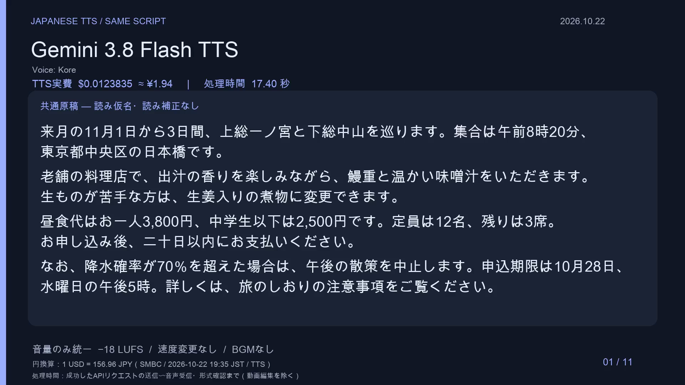

# 日本語TTS 聞き比べ — OpenRouterの11モデルを同じ難読原稿で比較

**難しい地名・漢字・日付・金額を、どれくらい自然に、正確に読めるか。**
OpenRouter経由で11モデルに同じ262文字の日本語原稿を渡し、比較動画・原音・費用・処理時間を公開しました。
検証日は **2026年10月22日**。各モデル1回の成功音声を採用した実用比較です。

## まず動画を見る

[](video/japanese-tts-labeled.mp4)

- **[▶ モデル名付きの全体動画（10分17秒・約21MB）](video/japanese-tts-labeled.mp4)**
- **[▶ モデル名を伏せた全体動画（10分17秒・約21MB）](video/japanese-tts-blind.mp4)**
- 気になるモデルだけ聞く場合は、下の表の「個別動画」を開いてください。各約50〜60秒です。
- 全体・個別動画とも、各モデルの **TTS実費（USD／参考JPY）・実測処理時間・同じ原稿** を画面に表示しています。
- ファイル画面で再生できない場合は「Download raw file」からMP4を保存してください。音声はAIで生成したものです。

## 作者が聞いてみた感想

**手早くナレーション付き動画を作るならGemini 3.8 Flash TTS。手間をかけて声のよい動画を作るならEleven v4。**

| モデル | 今回の音声を聞いた作者の感想 |
|---|---|
| Gemini 3.8 Flash TTS | 違和感がなく、難しい漢字の読みやイントネーションもよい。今回の試聴では最も正確だと感じた。 |
| Eleven v4 | 多少読み間違いはあるが、声が自然。声のよさを重視する場合の候補。 |
| Fish Audio Drama 3 | AIらしい声ではあるが、読み方が正確で聞き取りやすい。 |

Shinが2026年10月22日に今回の比較音声を試聴した感想を整理したものです。
「手間」は制作時の使い勝手についての主観で、API処理時間を指すものではありません。
全モデルの読みを語ごとに採点した結果や、複数人によるMOS評価ではありません。声の好みも含まれるので、ぜひ実際の動画を聞いて比べてください。

## モデル別の動画・費用・時間

費用は**今回の原稿1回分のTTS生成**について、OpenRouterの生成履歴APIで確認した実費です。
音声1分あたりの単価や、モデルの定価そのものではありません。

| モデル（公式ページ） | Voice | 個別動画 | TTS実費 USD | 参考JPY | 処理時間 | 音声長 |
|---|---|---|---:|---:|---:|---:|
| [Gemini 3.8 Flash TTS](https://openrouter.ai/google/gemini-3.8-flash-tts) | Kore | [▶ 再生](video/models/gemini38.mp4) | $0.0123835 | ¥1.94 | 17.40秒 | 54.64秒 |
| [Eleven v4](https://openrouter.ai/elevenlabs/eleven-v4) | sarah | [▶ 再生](video/models/eleven4.mp4) | $0.0209600 | ¥3.29 | 12.12秒 | 51.20秒 |
| [Eleven v4 Turbo](https://openrouter.ai/elevenlabs/eleven-v4-turbo) | sarah | [▶ 再生](video/models/eleven4turbo.mp4) | $0.0104800 | ¥1.64 | 5.35秒 | 50.80秒 |
| [Gemini 3.8 Flash-Lite TTS](https://openrouter.ai/google/gemini-3.8-flash-lite-tts) | Kore | [▶ 再生](video/models/gemini38lite.mp4) | $0.0076250 | ¥1.20 | 10.75秒 | 50.24秒 |
| [Fish Audio Drama 3](https://openrouter.ai/fish-audio/drama-3) | 既定音声（指定なし） | [▶ 再生](video/models/drama3.mp4) | $0.0014400 | ¥0.23 | 5.83秒 | 54.78秒 |
| [Fish Audio S2.1 Pro](https://openrouter.ai/fish-audio/s2.1-pro) | 既定音声（指定なし） | [▶ 再生](video/models/fish21.mp4) | $0.0108000 | ¥1.70 | 17.36秒 | 49.03秒 |
| [Fish Audio S2 Pro](https://openrouter.ai/fish-audio/s2-pro) | 既定音声（指定なし） | [▶ 再生](video/models/fish2.mp4) | $0.0108000 | ¥1.70 | 16.51秒 | 47.70秒 |
| [Qwen-Audio 3.0 TTS Plus](https://openrouter.ai/qwen/qwen-audio-3.0-tts-plus) | longanlingxin | [▶ 再生](video/models/qwenplus.mp4) | $0.0075400 | ¥1.18 | 11.24秒 | 49.42秒 |
| [Qwen-Audio 3.0 TTS Flash](https://openrouter.ai/qwen/qwen-audio-3.0-tts-flash) | loongjohn | [▶ 再生](video/models/qwenflash.mp4) | $0.0056550 | ¥0.89 | 7.68秒 | 57.34秒 |
| [Eleven v3](https://openrouter.ai/elevenlabs/eleven-v3) | sarah | [▶ 再生](video/models/eleven3.mp4) | $0.0209600 | ¥3.29 | 17.23秒 | 52.24秒 |
| [Gemini 3.1 Flash TTS Preview](https://openrouter.ai/google/gemini-3.1-flash-tts-preview) | Kore | [▶ 再生](video/models/gemini31.mp4) | $0.0515640 | ¥8.09 | 21.19秒 | 49.00秒 |

モデルID・音声設定・未丸めの数値は [results.csv](results.csv) と [metadata/model-configs.json](metadata/model-configs.json) に保存しています。
対象はOpenRouterでspeech出力として提供されていた11モデルです。OpenRouter全モデルを網羅した比較ではなく、Qwen-Omni等のチャットモデルは今回の音声比較に含めていません。

### 費用と時間の見方

- **処理時間**：成功したAPIリクエストの送信から、音声全体の受信・ファイル保存・ffprobeでの形式確認まで。ネットワーク時間を含みます。音声の再生時間とは別で、失敗・待機・音量調整・動画編集は含みません。
- **参考JPY**：1 USD = **156.96 JPY**。[三井住友銀行](https://www2.smbc.co.jp/ex/ExchangeServlet?ScreenID=real)の2026年10月22日19:35 JST時点のTTS（円貨→外貨）。カード請求時の円建て実費ではありません。[換算根拠](metadata/exchange-rate.json)
- TTS合計：**$0.16020750 ≈ ¥25.15**。補助ASRも含めた合計：**$0.16209355 ≈ ¥25.44**。[課金記録](metadata/billing.json)
- 各1回・最大3並列の実測です。速度の安定性や統計的な優劣は評価していません。
- Gemini 3.8 Flashは初回のMP3指定がHTTP 400（0.236秒）となり、PCM指定で成功した17.399秒を採用しました。失敗分には生成IDが返らず、課金表は成功生成の確認可能な額です。

## 全モデルに渡した共通台本

読み仮名・SSML・正解の読みを渡していません。[入力ファイル](script.txt)

来月の11月1日から3日間、上総一ノ宮と下総中山を巡ります。集合は午前8時20分、東京都中央区の日本橋です。

老舗の料理店で、出汁の香りを楽しみながら、鰻重と温かい味噌汁をいただきます。生ものが苦手な方は、生姜入りの煮物に変更できます。

昼食代はお一人3,800円、中学生以下は2,500円です。定員は12名、残りは3席。お申し込み後、二十日以内にお支払いください。

なお、降水確率が70％を超えた場合は、午後の散策を中止します。申込期限は10月28日、水曜日の午後5時。詳しくは、旅のしおりの注意事項をご覧ください。

## 比較条件と限界

- 各モデルの最初に成功した音声を採用。読み間違い・話速・間を修正せず、BGMも加えていません。
- instructions / speed / temperatureは全モデルで未指定。GoogleはKore、ElevenLabsはsarah、Qwenは当日のカタログ先頭音声、Fishはvoice未指定のプロバイダー既定音声です。
- 声の違いを含む実用比較です。モデル単体の能力と声の好みを分離できる実験ではありません。
- 原音は [audio/raw](audio/raw)。比較動画では音量だけ約−18 LUFSに統一。Googleは24kHz・16bit・mono PCMをWAVで包み、他モデルはMP3で取得。動画音声は48kHz mono AACです。
- モデル名を伏せた版は同じ音声を固定シャッフルしたA〜Kです。費用・時間も表示するため、数値からモデルを推測できる場合があります。
- 1つの原稿・1つのvoice・1回の生成結果です。日本語TTS全体の「最高」を確定する公開ベンチマークではありません。価格、提供状況、モデルの実体は今後変わる可能性があります。

### 読みの確認と評価

[想定される読み](docs/reading-guide.md)に、上総一ノ宮・下総中山・日本橋・鰻重・二十日などの確認ポイントをまとめました。許容できる別の読みを機械的に不正解にしないようにしてください。

[評価票](evaluation-sheet.csv)では、**自然さ／読み間違い／アクセント／間／声の好み**を分けて記録できます。
モデル名を伏せて視聴したあと、[対応表](blind-answer-key.json)を確認してください。

補助チェックとして、原稿をヒントに与えずWhisper Large v3 Turboで書き起こしました。[ASR結果](metadata/transcripts)
地名、鰻重、数字等に表記・内容の差が出ましたが、ASRの聞き間違いも含まれるため、これをTTSの読み間違いや漢字読み正解率として扱っていません。
作者の上記の試聴メモとは別に、全モデルに対する語単位の正誤表やMOSスコアは作成していません。

## ファイル構成

```text
video/japanese-tts-labeled.mp4  モデル名付きの全体動画
video/japanese-tts-blind.mp4    モデル名を伏せた全体動画
video/models/                 11モデルの個別動画
assets/                       動画のプレビュー画像
audio/raw/                    APIから受信した原音（PCMにはWAVも同梱）
script.txt                    共通入力
results.csv                   モデル・voice・長さ・USD・参考JPY・処理時間
metadata/                     当日のカタログ・設定・成功/失敗ログ・費用・検証記録
docs/reading-guide.md          手作業で用意した読みの確認表
scripts/                      音声生成・補助ASR・動画作成・検証
```

APIキー、アカウント固有の認証設定・生成ID、ローカルの絶対パス、社内の会話ログは含めていません。
公開した感想は作者本人の今回のTTS試聴に関する内容だけです。

## 動画を手元で作り直す（API不要）

Python 3.10以降、ffmpeg / ffprobe、日本語フォントが必要です。
macOSではArial Unicode、LinuxではNoto Sans CJK等を検出します。見つからない場合は、フォントファイルを `JAPANESE_TTS_FONT` に指定してください。欧文は `JAPANESE_TTS_LATIN_FONT` で変更できます。

```sh
git clone https://github.com/ryoshin0830/japanese-tts-comparison.git
cd japanese-tts-comparison
python3 -m venv .venv
source .venv/bin/activate
python3 -m pip install -r requirements.txt
python3 scripts/render.py --workers 3
python3 scripts/verify.py
```

保存済みの原音・費用・時間を使って、音量調整と動画化を行います。追加のAPI課金はありません。
フォントやffmpegのバージョンによって見た目・エンコード結果が変わる場合があります。
検証結果は [metadata/verification.json](metadata/verification.json) に保存します。全編デコード、同じ原稿、原音ハッシュ、音量、費用・時間と表示の一致を検証します。

### APIに同じ設定で問い合わせる

音声生成・補助ASRのスクリプトは `OPENROUTER_API_KEY` を環境変数として読みます。秘密情報をファイルやコマンド履歴に記録しない方法で設定してください。

```sh
python3 scripts/generate.py --workers 3
python3 scripts/transcribe.py
```

成功済みの音声と書き起こしは再利用します。新しく生成する場合は別の作業コピーで当該モデルの原音・メタデータを退避してから実行してください。API利用料が発生します。
同じ設定でも生成音声・費用・処理時間が変わります。新しい結果を公開する場合は、その生成の課金情報を取得して `metadata/billing.json`、換算レート、結果表も更新してください。今回の費用を再生成時の実費として扱わないでください。

## 公式資料

- [OpenRouter Text-to-Speech](https://openrouter.ai/docs/guides/overview/multimodal/tts)
- [speech出力モデルの公式カタログAPI](https://openrouter.ai/api/v1/models?output_modalities=speech)（検証時の応答は [metadata/models-speech.json](metadata/models-speech.json)）
- [OpenRouterの補助ASRの説明](https://openrouter.ai/blog/tutorials/transcription-on-openrouter/)
- [GitHubのファイル容量制限](https://docs.github.com/en/repositories/working-with-files/managing-large-files/about-large-files-on-github)

コードと独自に作成した文章は [MIT License](LICENSE) で公開します。合成音声・動画に含まれる各サービスの生成物や第三者の資料について、提供元の権利・利用条件を変更するものではありません。
